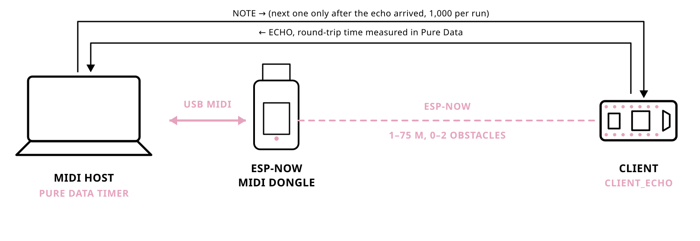

# 0.10.7 round-trip benchmarks

Measured 2026-03-22 to 2026-03-27 (ESP-NOW runs on 2026-03-26), on library
version 0.10.7. The files do not record the firmware version; it is taken from
git: the ESP-NOW data was committed in 6b8106e, 43c6ce3 and 927f976, one to
three commits after the 0.10.7 tag, with no library code changes in between.
BLE, RTP and USB data were committed between 0.10.5 and 0.10.7 and rewritten
in 5430b0a (0.10.7); they do not run this library's ESP-NOW code and serve as
comparison.

Setup: Pure Data on macOS (`pd-patches/benchmark_client-echo_rtt.pd`) sends a
note, waits for it to come back, 1,000 times per file. ESP-NOW: computer, USB,
dongle, ESP-NOW, `client_echo`, back the same way.

- `espnowMidi/<distance>_obstacles-<n>.txt`: ESP-NOW MIDI, 1 to 75 m
- `bleMidi/`: BLE MIDI (`*_m4_m1_osx`: Mac to Mac)
- `rtpMidi/`: RTP-MIDI (network MIDI)
- `usbMidi/`: USB MIDI loopback, baseline of the host-side measurement

One round-trip time in ms per line; `*_analysis.txt` from
`scripts/analyze_benchmark.py`.
