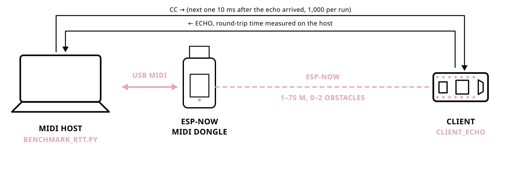

# 0.10.8 round-trip benchmarks

Measured 2026-03-22 to 2026-03-27 (ESP-NOW runs on 2026-03-26), on library
version 0.10.8. The files do not record the firmware version; it is taken from
git: the ESP-NOW data was committed in 6b8106e, 43c6ce3 and 927f976, after the
0.10.7 tag, and released with 0.10.8. The library code of 0.10.7 and 0.10.8 is
identical apart from the version number (`version.h`, `library.properties`);
0.10.8 also adds the `client_vl53l0x` example and changes the README and
`scripts/analyze_benchmark.py`, none of which runs on the boards in these
measurements. The results therefore hold for both versions. BLE, RTP and USB
data were first committed for 0.10.6 (e6e9e66) and rewritten in 5430b0a
(0.10.8); they do not run this library's ESP-NOW code and serve as comparison.

Setup: Pure Data on macOS (`pd-patches/benchmark_client-echo_rtt.pd`) sends a
control change, waits for it to come back, 1,000 times per file. Its timer
advances in steps of about 5.3 ms, so the values sit on that grid (6.00,
11.33, 16.67 ms ...). ESP-NOW: computer, USB,
dongle, ESP-NOW, `client_echo`, back the same way.

- `espnowMidi/<distance>_obstacles-<n>.txt`: ESP-NOW MIDI, 1 to 75 m
- `bleMidi/`: BLE MIDI (`*_m4_m1_osx`: Mac to Mac)
- `rtpMidi/`: RTP-MIDI (network MIDI)
- `usbMidi/`: USB MIDI loopback, baseline of the host-side measurement

One round-trip time in ms per line; `*_analysis.txt` from
`scripts/analyze_benchmark.py`.
