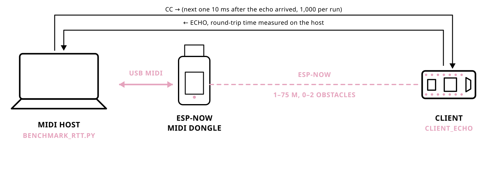

# Benchmarks

The benchmarks measure round-trip time across the complete stack: computer,
the timing program, USB MIDI, ESP-NOW transmission, ESP32 processing, the return ESP-NOW
transmission, ESP32 processing, USB MIDI, and finally the timing program on the computer.
The results therefore represent end-to-end performance rather than ESP-NOW
radio latency alone.

For isolated ESP-NOW radio latency, consult ESP-NOW-specific research papers:
they have hopefully already done that homework better than this MIDI benchmark
intends to.

Each run sends 1,000 control change messages; the next one goes out 10 ms
after the previous one came back. The diagram shows the current setup with
`scripts/benchmark_rtt.py` as the timing program; the 0.10.8 runs used the
same path with Pure Data (`pd-patches/benchmark_client-echo_rtt.pd`) in its
place.

The two timing programs differ in resolution, so their numbers are not
directly comparable:

- **0.10.8, Pure Data:** its timer advances in steps of about 5.3 ms, so the
  values sit on a grid (6.00, 11.33, 16.67, 22.00 ms) and a 6 ms result can be
  anything from about 1 to 6 ms. One run of 1,000 messages per row.
- **0.19.1, `scripts/benchmark_rtt.py`:** timestamps in the MIDI input
  callback with sub-millisecond resolution. 10 runs of 1,000 messages per row,
  pooled (10,000 samples).

These results should be taken with a grain of salt because operating-system
MIDI scheduling and the measurement setup can both influence
the observed timing.

Nevertheless, the results show that ESP-NOW MIDI is consistently faster than
BLE MIDI in these tests, and its latency is well suited to musical
applications. Jitter depends on the version:

- **0.10.8:** ESP-NOW MIDI shows more jitter than BLE MIDI (standard deviation
  about 10 ms against about 4 ms at 1–5 m).
- **0.19.1:** most ESP-NOW round trips are now tightly grouped, and the
  standard deviation (about 3.5 ms) is below BLE's 0.10.8 values. A small
  share of slow messages remains, so its slowest 5 % still arrive further from
  the median than with BLE (P95 minus median about 9 ms, against about 5 ms for
  BLE at 1–3 m). BLE was not measured again for 0.19.1, and the BLE values
  come from the coarser Pure Data timer.

Benchmark data and analysis live in the repository's
[`benchmarks/`](https://github.com/grantler-instruments/ESP-NOW-MIDI/tree/main/benchmarks)
directory, one subdirectory per library version, together with how to run the
benchmarks (`scripts/benchmark.sh`).

## 0.19.1: ESP-NOW MIDI results by distance

All values are round-trip times in milliseconds, each row pooled from 10 runs
of 1,000 messages; Stdev is the sample standard deviation. Data:
[`benchmarks/0.19.1/`](https://github.com/grantler-instruments/ESP-NOW-MIDI/tree/main/benchmarks/0.19.1).

| Distance | Obstacles | Samples | Lost | Min | Median | Mean | P95 | P99 | P99.9 | Max | Stdev | MAD |
| ---: | ---: | ---: | ---: | ---: | ---: | ---: | ---: | ---: | ---: | ---: | ---: | ---: |
| 1 m | 0 | 10,000 | 0 | 4.55 | 4.91 | 5.90 | 13.99 | 24.54 | 29.67 | 39.96 | 3.37 | 0.14 |
| 3 m | 0 | 10,000 | 0 | 4.55 | 4.93 | 6.15 | 14.37 | 24.71 | 29.65 | 31.60 | 3.65 | 0.16 |
| 5 m | 1 | 10,000 | 0 | 4.57 | 4.90 | 5.88 | 13.77 | 24.78 | 29.65 | 32.22 | 3.54 | 0.11 |

- Distance up to 5 m and one obstacle make no measurable difference.
- About 9 in 10 round trips are within 2 ms of the median. The rest form a
  small group of slow messages (about 6 % at 12–20 ms, 1–2 % at 20–30 ms),
  capped near 29.6 ms with only a few above; its cause is not known yet.
- Against 0.10.8 at 1 m and 3 m (same conditions) and at 5 m (0.19.1 with
  1 obstacle, 0.10.8 with none), the median drops from 6–11 ms to 4.9 ms, P95
  from 32.7 ms to about 14 ms and the standard deviation from about 10 ms to
  about 3.5 ms.

## 0.10.8: ESP-NOW MIDI results by distance

All values are round-trip times in milliseconds, timed in Pure Data. Each row
contains 1,000 samples; Stdev is the sample standard deviation. Data:
[`benchmarks/0.10.8/`](https://github.com/grantler-instruments/ESP-NOW-MIDI/tree/main/benchmarks/0.10.8).

| Distance | Obstacles | Min | P25 | Median | Mean | P75 | P95 | P99 | Max | Stdev | MAD |
| ---: | ---: | ---: | ---: | ---: | ---: | ---: | ---: | ---: | ---: | ---: | ---: |
| 1 m | 0 | 6.00 | 6.00 | 6.00 | 13.79 | 22.00 | 32.67 | 38.00 | 64.67 | 9.85 | 0.00 |
| 3 m | 0 | 6.00 | 6.00 | 11.33 | 14.49 | 22.00 | 32.67 | 38.00 | 96.67 | 10.01 | 5.33 |
| 5 m | 0 | 6.00 | 6.00 | 11.33 | 14.90 | 22.00 | 32.67 | 38.00 | 54.00 | 10.18 | 5.33 |
| 7 m | 0 | 6.00 | 6.00 | 6.00 | 13.41 | 22.00 | 32.67 | 38.00 | 38.00 | 9.31 | 0.00 |
| 10 m | 1 | 6.00 | 6.00 | 6.00 | 14.19 | 22.00 | 32.67 | 38.00 | 48.67 | 10.28 | 0.00 |
| 15 m | 2 | 6.00 | 6.00 | 9.67 | 13.91 | 22.00 | 32.67 | 38.00 | 48.67 | 9.57 | 3.67 |
| 20 m | 0 | 6.00 | 6.00 | 11.33 | 16.30 | 22.00 | 32.67 | 48.67 | 155.33 | 11.38 | 5.33 |
| 40 m | 0 | 6.00 | 6.00 | 16.67 | 18.88 | 27.33 | 38.00 | 64.67 | 128.67 | 13.42 | 10.67 |
| 50 m | 0 | 6.00 | 6.00 | 16.67 | 18.98 | 27.33 | 43.33 | 59.33 | 187.33 | 14.21 | 10.67 |
| 75 m | 0 | 6.00 | 6.00 | 16.67 | 18.29 | 27.33 | 38.00 | 54.00 | 102.00 | 12.46 | 10.67 |

## 0.10.8: comparison results

All values are round-trip times in milliseconds, timed in Pure Data. Each row
contains 1,000 samples; Stdev is the sample standard deviation. USB MIDI is a
wired loopback baseline for the host-side measurement stack.

| Protocol | Distance | Obstacles | Min | Median | Mean | P95 | P99 | Max | Stdev | MAD |
| --- | ---: | ---: | ---: | ---: | ---: | ---: | ---: | ---: | ---: | ---: |
| USB MIDI | 1 m | n/a | 0.67 | 1.33 | 1.25 | 1.33 | 2.67 | 13.33 | 0.76 | 0.00 |
| BLE MIDI | 1 m | 0 | 32.67 | 43.33 | 44.11 | 48.67 | 59.33 | 91.33 | 4.39 | 0.00 |
| BLE MIDI | 3 m | 0 | 32.67 | 43.33 | 44.10 | 48.67 | 59.33 | 64.67 | 4.03 | 0.00 |
| BLE MIDI | 5 m | 1 | 32.67 | 43.33 | 44.20 | 54.00 | 59.33 | 70.00 | 4.13 | 0.00 |
| BLE MIDI | 10 m | 2 | 32.67 | 43.33 | 47.22 | 64.67 | 80.67 | 107.33 | 7.89 | 0.00 |
| RTP-MIDI | 1 m | 0 | 16.67 | 22.00 | 30.86 | 59.33 | 118.00 | 139.33 | 19.01 | 0.00 |
