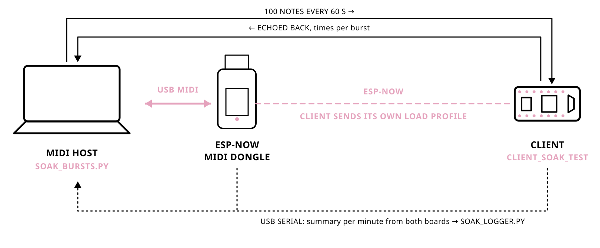

# Benchmarks

The benchmarks measure round-trip time across the complete stack: computer,
Pure Data, USB MIDI, ESP-NOW transmission, ESP32 processing, the return ESP-NOW
transmission, ESP32 processing, USB MIDI, and finally Pure Data on the computer.
The results therefore represent end-to-end performance rather than ESP-NOW
radio latency alone.

For isolated ESP-NOW radio latency, consult ESP-NOW-specific research papers:
they have hopefully already done that homework better than this MIDI benchmark
intends to.

Results were measured in Pure Data using its built-in timer. Each benchmark
used a batch of 1,000 messages, with the next message sent only after the
previous message had completed the round trip.

These results should be taken with a grain of salt because operating-system
MIDI scheduling and the measurement setup within Pure Data can both influence
the observed timing.

Nevertheless, the results show that ESP-NOW MIDI is consistently faster than
BLE MIDI in these tests. Its latency is well suited to musical applications,
though it shows somewhat more jitter than BLE MIDI, as the spread values in
the tables below indicate.

The round-trip results below were measured with library version 0.10.7.
Benchmark data and analysis live in the repository's
[`benchmarks/`](https://github.com/grantler-instruments/ESP-NOW-MIDI/tree/main/benchmarks)
directory, one subdirectory per library version (these:
[`benchmarks/0.10.7/`](https://github.com/grantler-instruments/ESP-NOW-MIDI/tree/main/benchmarks/0.10.7)),
and the analysis script in `scripts/`.

## ESP-NOW MIDI results by distance

All values are round-trip times in milliseconds. Each row contains 1,000
samples; Stdev is the sample standard deviation.

| Distance | Obstacles | Min | P25 | Median | Mean | P75 | P95 | P99 | Max | Stdev | MAD |
| ---: | ---: | ---: | ---: | ---: | ---: | ---: | ---: | ---: | ---: | ---: | ---: |
| 1 m | 0 | 6.00 | 6.00 | 6.00 | 13.79 | 22.00 | 32.67 | 38.00 | 64.67 | 9.85 | 0.00 |
| 3 m | 0 | 6.00 | 6.00 | 11.33 | 14.49 | 22.00 | 32.67 | 38.00 | 96.67 | 10.01 | 5.33 |
| 5 m | 0 | 6.00 | 6.00 | 11.33 | 14.90 | 22.00 | 32.67 | 38.00 | 54.00 | 10.18 | 5.33 |
| 7 m | 0 | 6.00 | 6.00 | 6.00 | 13.41 | 22.00 | 32.67 | 38.00 | 38.00 | 9.31 | 0.00 |
| 10 m | 1 | 6.00 | 6.00 | 6.00 | 14.19 | 22.00 | 32.67 | 38.00 | 48.67 | 10.28 | 0.00 |
| 15 m | 2 | 6.00 | 6.00 | 9.67 | 13.91 | 22.00 | 32.67 | 38.00 | 48.67 | 9.57 | 3.67 |
| 20 m | 0 | 6.00 | 6.00 | 11.33 | 16.30 | 22.00 | 32.67 | 48.67 | 155.33 | 11.38 | 5.33 |
| 40 m | 0 | 6.00 | 6.00 | 16.67 | 18.88 | 27.33 | 38.00 | 64.67 | 128.67 | 13.42 | 10.67 |
| 50 m | 0 | 6.00 | 6.00 | 16.67 | 18.98 | 27.33 | 43.33 | 59.33 | 187.33 | 14.21 | 10.67 |
| 75 m | 0 | 6.00 | 6.00 | 16.67 | 18.29 | 27.33 | 38.00 | 54.00 | 102.00 | 12.46 | 10.67 |

## Comparison results

All values are round-trip times in milliseconds. Each row contains 1,000
samples; Stdev is the sample standard deviation. USB MIDI is a wired loopback
baseline for the host-side measurement stack.

| Protocol | Distance | Obstacles | Min | Median | Mean | P95 | P99 | Max | Stdev | MAD |
| --- | ---: | ---: | ---: | ---: | ---: | ---: | ---: | ---: | ---: | ---: |
| USB MIDI | 1 m | n/a | 0.67 | 1.33 | 1.25 | 1.33 | 2.67 | 13.33 | 0.76 | 0.00 |
| BLE MIDI | 1 m | 0 | 32.67 | 43.33 | 44.11 | 48.67 | 59.33 | 91.33 | 4.39 | 0.00 |
| BLE MIDI | 3 m | 0 | 32.67 | 43.33 | 44.10 | 48.67 | 59.33 | 64.67 | 4.03 | 0.00 |
| BLE MIDI | 5 m | 1 | 32.67 | 43.33 | 44.20 | 54.00 | 59.33 | 70.00 | 4.13 | 0.00 |
| BLE MIDI | 10 m | 2 | 32.67 | 43.33 | 47.22 | 64.67 | 80.67 | 107.33 | 7.89 | 0.00 |
| RTP-MIDI | 1 m | 0 | 16.67 | 22.00 | 30.86 | 59.33 | 118.00 | 139.33 | 19.01 | 0.00 |

## Soak test (0.19.0)

A 10 h run of `client_soak_test` with 100-note bursts from the computer every
60 s: no stalls or ESP-NOW restarts, all 60,000 notes reached the client and
99.5 % came back. Details and logs:
[`benchmarks/0.19.0/soak/`](https://github.com/grantler-instruments/ESP-NOW-MIDI/tree/main/benchmarks/0.19.0/soak).
